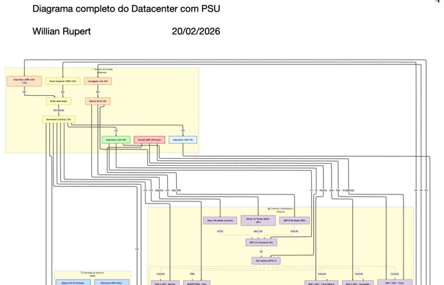
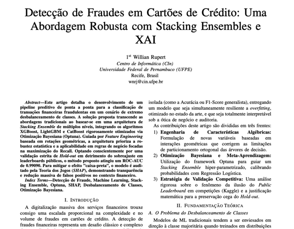
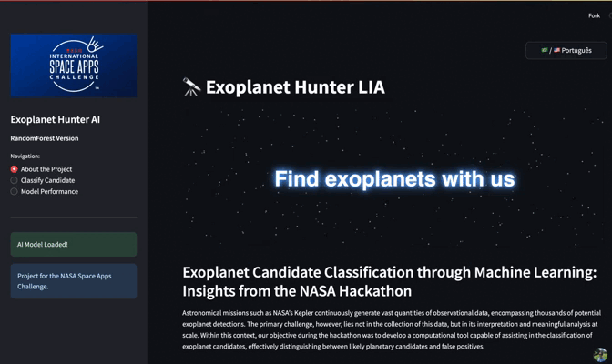
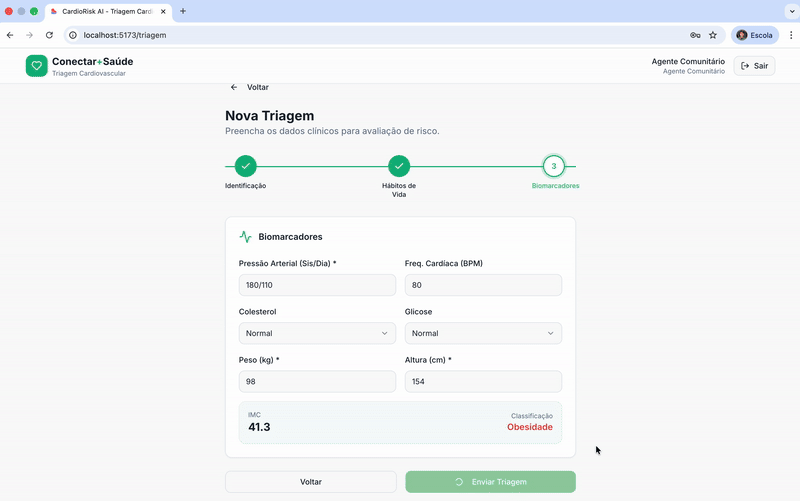
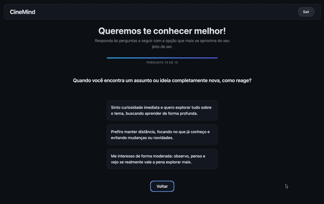
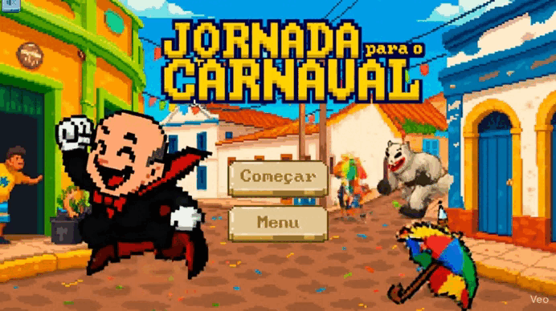
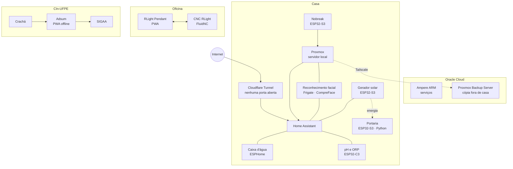

<picture>
  <source media="(prefers-color-scheme: dark)" srcset="assets/hero-dark.svg">
  
</picture>

  

<a href="https://rlight.com.br"><b>rlight.com.br</b></a>
&nbsp;&nbsp;·&nbsp;&nbsp;
<a href="https://www.linkedin.com/in/willianrupert"><b>LinkedIn</b></a>
&nbsp;&nbsp;·&nbsp;&nbsp;
<a href="mailto:wnrj@cin.ufpe.br"><b>wnrj@cin.ufpe.br</b></a>

 

Estudo Ciência da Computação no Centro de Informática da UFPE, e a eletrônica me
acompanha desde sempre. O que mais gosto de construir fica na fronteira entre as duas
coisas: um ESP32 que precisa sobreviver a um apagão, um app que um professor abre no
meio da aula, uma tela de oficina que precisa dizer a verdade sobre a máquina.

Meu jeito de trabalhar cabe numa frase: **decidir o que importa agora e esconder o
resto atrás de bons padrões.** Testes contra hardware de verdade, falhas que avisam
em vez de calar, e nada de complexidade que o usuário não pediu. É o que faço no
[**RLight**](https://rlight.com.br), o meu estúdio de engenharia.

 

<picture>
  <source media="(prefers-color-scheme: dark)" srcset="assets/terminal-dark.svg">
  
</picture>

  

## Em produção

Quatro sistemas que outras pessoas usam todos os dias.

Clique em um cartão para abrir o projeto, ou abra os detalhes abaixo.

<b>Adsum</b>&nbsp; · &nbsp;por que uma chamada sem servidor

 

Feito com o **Prof. Paulo Freitas** para o CIn-UFPE e em uso em sala de aula. O aluno
encosta o crachá, a presença é registrada, e no fim da aula existe uma planilha
pronta para o SIGAA.

- **A pasta é a verdade.** Os dados ficam numa pasta do computador do professor; o
  navegador é só cache. "Dados 100% locais" não pode virar "perder tudo".
- **O leitor é um teclado.** O dongle USB digita o crachá. O app separa rajada de
  máquina de digitação humana pelo ritmo das teclas.
- **Testado com hardware de verdade.** Um ESP32-S3 se passando por teclado USB
  simulou uma turma de 200 pessoas: todas as leituras registradas.
- **Uma tela que não pergunta o que já podia saber.** Numa fila de cinquenta
  alunos, cada pergunta é uma pessoa esperando.

[Abrir o app](https://willianrupert.github.io/adsum/) ·
[Ver todas as telas](https://willianrupert.github.io/adsum/#/vitrine) ·
[Código](https://github.com/willianrupert/adsum)

<b>RLight Pendant</b>&nbsp; · &nbsp;uma interface de CNC que não mente

 

Interfaces de CNC costumam ser painéis com todo parâmetro na tela e todo erro em
código. O Pendant é um PWA servido na rede da oficina, para iPhone e Android, sem loja.

- **Uma régua em vez de botões de jog.** Arraste e a máquina acompanha o dedo; um
  peteleco segue por inércia, com o destino anunciado antes de chegar.
- **Toque na mesa e "Ir".** O tempo restante diminui ao vivo, calculado com as
  rampas de aceleração da própria máquina.
- **Uma conexão honesta.** Nada é enfileirado sem sinal, e todo movimento é uma
  intenção completa e idempotente: se o celular some, a máquina termina ou para.
- **Nenhum valor de máquina no código.** Curso, limites e spindle vêm da placa
  (`$CD`). Funciona com qualquer FluidNC.

[Experimentar no navegador](https://willianrupert.github.io/rlight-pendant/) ·
[Código](https://github.com/willianrupert/rlight-pendant)

<b>Portaria</b>&nbsp; · &nbsp;uma casa que recebe encomendas sozinha

 

Em produção desde julho de 2026, numa casa com duas portas em série. O entregador
digita o código da etiqueta, deixa o pacote na balança e sai; a portaria pesa,
fotografa e avisa o morador com a foto da entrega.

- **Nenhuma entrega se perde por falta de internet.** Tudo é gravado primeiro no
  local e sobe para a nuvem por uma fila com confirmação.
- **Interlock.** A porta de casa nunca abre com a da rua aberta.
- **O hardware sente, o software decide.** O ESP32-S3 só lê sensores e aciona
  travas; toda a lógica roda em Python, coberta por testes.
- **Deploy seguro.** A portaria só se atualiza quando está ociosa.

Código privado.

<b>Caixa d'água</b>&nbsp; · &nbsp;um tanque de guerra com um botão só

 

Controla o bombeamento da cisterna para a caixa d'água. A lógica de segurança roda
inteira no ESP32; Wi-Fi e Home Assistant são só telemetria. Se a rede cair, o
sistema nem percebe.

- **Máquina de 10 estados** persistida em flash, com recuperação segura pós-apagão.
- **Corrente fantasma:** relé desligado e corrente no motor significa contator
  soldado, e vira alarme.
- **Sensor supervisionado** como em central de alarme: cabo rompido ou em curto
  é detectado.
- **Um botão, duas intenções,** e um LED RGB em que cada estado tem uma cor.

[Código](https://github.com/willianrupert/caixa-dagua-esphome)

 

## Hardware e casa

| | | |
|:--|:--|:--|
| **[Nobreak inteligente](https://github.com/willianrupert/ProjetoPSU)** | Nobreak para o homelab, com um laço crítico de hardware separado do laço de interface: a tela travar nunca queima o equipamento. | `ESP32-S3` `ESPHome` `C++` `LVGL` |
| **Gerador solar** | Backup solar de 1,1 kW para a rede crítica da casa, câmeras e Portaria incluídas. No apagão, a troca de fonte é verificada, e um OLED mostra um número por vez, legível mesmo sem Wi-Fi. | `ESP32-S3` `ESPHome` `Home Assistant` |
| **[pH e ORP sem nuvem](https://github.com/willianrupert/ProjetoPH_ORP)** | Engenharia reversa do protocolo serial Tuya de um monitor de qualidade de água. O módulo Wi-Fi original deu lugar a um ESP32-C3. | `ESP32-C3` `ESPHome` `UART` |
| **CNC RLight** | Migração de uma fresadora de doze anos do Mach3 para o FluidNC, preservando as telas e macros do construtor. Migrar exatamente primeiro, otimizar depois. | `FluidNC` `ESP32` `G-code` |
| **Infraestrutura RLight** | Um Proxmox em casa roda o Home Assistant, reconhecimento facial local e as fotos da família. Nenhuma porta aberta no roteador: tudo entra por Cloudflare Tunnel e Tailscale. Na Oracle Cloud, um bastion, um servidor ARM e um Proxmox Backup Server guardam a cópia fora de casa, incremental e deduplicada. | `Proxmox` `Home Assistant` `Cloudflare` `Tailscale` `Oracle Cloud` |

## Dados e IA

| | | |
|:--|:--|:--|
| **[Inadimplência · Praso](https://github.com/willianrupert/Equipe-12-ML)** | Dois modelos de risco com dados reais sob confidencialidade, um de cadastro e um comportamental, e como entrariam numa política de crédito. | `Python` `Jupyter` `ROC-AUC` |
| **[Fraude e XAI](https://github.com/willianrupert/projeto_ml_ligia)** | Detecção de fraude com stacking ensembles e explicabilidade, com artigo em formato IEEE. | `Python` `CatBoost` `XAI` |
| **[PRF 2022–2024](https://github.com/willianrupert/Grupo-6-PRF)** | Mais de 14 milhões de autuações num data warehouse em esquema estrela. | `PostgreSQL` `dbt` `Python` |
| **[Motor de prompts](https://github.com/willianrupert/vlab-desafio-prompt-engine)** | Gera aulas para o perfil de cada aluno e alimenta um [hub educacional fullstack](https://github.com/willianrupert/vlab-desafio-hub-fullstack). | `FastAPI` `Gemini` `React` |
| **[Exoplanetas NASA](https://exoplanet-lia.streamlit.app/)** | Visualização interativa de dados de exoplanetas. | `Python` `Streamlit` |
| **[CineMind](https://github.com/willianrupert/CineMind)** | Recomendação de filmes com IA generativa, feito em equipe. | `Python` `TypeScript` |

<b>Na faculdade</b>&nbsp; · &nbsp;projetos de disciplina no CIn-UFPE

 

| | |
|:--|:--|
| [Redes · Grupo 13](https://github.com/willianrupert/redes-grupo-13) | Reestruturação da rede dos laboratórios do CIn: topologia, VLSM, VLANs e roteamento inter-VLAN. |
| [E-commerce em PL/SQL](https://github.com/willianrupert/ecommerce-db-grupo-5) | Modelagem relacional, integridade referencial e consultas de negócio. |
| [Farmácia em MongoDB](https://github.com/willianrupert/Grupo-6-MongoDB) | Modelagem de documentos e agregações no MongoDB Atlas. |
| [Escalonador de processos](https://github.com/willianrupert/APS5-ACSO) | Simulação de Round Robin e prioridade preemptiva. |
| [LIGIA Saúde](https://github.com/willianrupert/desafio-IA-LIGIA) | Predição de risco cardíaco e triagem. |
| [Projeto IP](https://github.com/AmandaTrinity/ProjetoIP) | Jogo da disciplina de Introdução à Programação. |

<b>Galeria</b>&nbsp; · &nbsp;alguns projetos em movimento

 

  
  
  
  
  
  

<b>Mapa</b>&nbsp; · &nbsp;como os sistemas se encaixam

 

 

## Ferramentas

  <picture>
    <source media="(prefers-color-scheme: dark)" srcset="https://skillicons.dev/icons?i=ts,react,vite,nodejs,py,fastapi,cpp,c,arduino&theme=dark">
    
  </picture>
   
  <picture>
    <source media="(prefers-color-scheme: dark)" srcset="https://skillicons.dev/icons?i=raspberrypi,linux,docker,postgres,mongodb,firebase,githubactions,git&theme=dark">
    
  </picture>

## Atividade

<picture>
  <source media="(prefers-color-scheme: dark)" srcset="https://raw.githubusercontent.com/willianrupert/willianrupert/output/github-contribution-grid-snake-dark.svg">
  
</picture>

  

<picture>
  <source media="(prefers-color-scheme: dark)" srcset="assets/rodape-dark.svg">
  
</picture>
